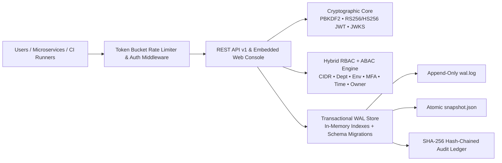

# AetherIAM

[](https://github.com/fully-ai/aetheriam/releases)
[](https://go.dev/)
[](#)
[](#)
[](LICENSE)

**Self-Hosted Identity, OAuth2/OIDC Token Issuer, Hybrid RBAC/ABAC Policy Engine, JWT/JWKS Discovery & Tamper-Evident Hash-Chained Audit Governance Platform.**

AetherIAM is a single-binary, zero-CGo identity and policy control plane engineered in pure Go. It unifies OAuth2/OIDC token issuance (`RS256` & `HS256`), salted PBKDF2-HMAC-SHA256 credential management, combined Role-Based (`RBAC`) and Attribute-Based (`ABAC`) zero-trust authorization with deterministic trace explanations, scoped `aiam_` API keys, and a SHA-256 hash-chained audit ledger with an embedded **AetherIAM Security & Identity Console**.

---

## Table of Contents

1. [Overview & Core Value Proposition](#1-overview--core-value-proposition)
2. [Key Features](#2-key-features)
3. [System Architecture](#3-system-architecture)
4. [Hybrid RBAC + ABAC Policy Evaluation Model](#4-hybrid-rbac--abac-policy-evaluation-model)
5. [Cryptographic & OIDC Standards Compliance](#5-cryptographic--oidc-standards-compliance)
6. [Tamper-Evident SHA-256 Hash-Chained Audit Ledger](#6-tamper-evident-sha-256-hash-chained-audit-ledger)
7. [Transactional WAL & Atomic Snapshot Storage Engine](#7-transactional-wal--atomic-snapshot-storage-engine)
8. [AetherIAM Security & Identity Console (Web UI)](#8-aetheriam-security--identity-console-web-ui)
9. [Quick Start (Local Binary)](#9-quick-start-local-binary)
10. [Docker & Docker Compose Deployment](#10-docker--docker-compose-deployment)
11. [CLI Flags & Environment Variables](#11-cli-flags--environment-variables)
12. [Default Seeded Demo Identities & Credentials](#12-default-seeded-demo-identities--credentials)
13. [REST API v1 Reference](#13-rest-api-v1-reference)
14. [End-to-End API Usage Examples (`curl`)](#14-end-to-end-api-usage-examples-curl)
15. [Prometheus Metrics & Health Probes](#15-prometheus-metrics--health-probes)
16. [Rate Limiting & Abuse Protection](#16-rate-limiting--abuse-protection)
17. [Online Atomic Backup & Hot Disaster Recovery](#17-online-atomic-backup--hot-disaster-recovery)
18. [Project Directory Structure](#18-project-directory-structure)
19. [Testing, Race Detection & Verification](#19-testing-race-detection--verification)
20. [Roadmap & License](#20-roadmap--license)

---

## 1. Overview & Core Value Proposition

Modern distributed systems and AI microservice fleets frequently require three capabilities that are traditionally split across separate products:
1. **Identity & Token Issuance**: OAuth2 `client_credentials` and `password` grants with standards-compliant OpenID Connect Discovery (`/.well-known/openid-configuration`) and JSON Web Key Sets (`/.well-known/jwks.json`).
2. **Fine-Grained Authorization**: A deterministic policy evaluator that merges RBAC role permission matrices with contextual ABAC constraints (IPv4/IPv6 CIDR blocks, department, environment, MFA verification state, resource ownership, and UTC time windows).
3. **Verifiable Governance**: An immutable, cryptographically linked SHA-256 audit ledger that proves no historical authorization or administrative record has been altered.

**AetherIAM** delivers all three in a zero-dependency Go binary with an embedded interactive web console.

---

## 2. Key Features

- **Salted PBKDF2-HMAC-SHA256 Password Hashing**: 60,000 iterations, 128-bit cryptographic random salt, and constant-time digest verification (`crypto/subtle`).
- **Dual-Algorithm JWT & JWKS Engine**: Sign and verify tokens using RSA-2048 (`RS256`) or HMAC-SHA256 (`HS256`) with automatic RSA key persistence (`jwt_rsa_key.pem`) and RFC 7517 JWKS discovery.
- **Combined RBAC + ABAC Policy Engine**: Zero-trust evaluation (`Implicit Deny`, `Explicit Deny Overrides Allow`) with microsecond latency and a step-by-step evaluation trace.
- **Live Interactive Policy Simulator**: Test complex authorization scenarios via `POST /api/v1/policies/evaluate` or from the Web UI before rolling rules into production.
- **Scoped Programmatic API Keys (`aiam_`)**: Issue high-entropy keys stored solely as SHA-256 digests with per-key role bindings, scopes, and RPS metadata.
- **Tamper-Evident Hash-Chained Audit Log**: Every event hashes the previous entry's SHA-256 digest (`GENESIS -> H_1 -> H_2 -> ... -> H_n`) and is continuously verified via `/api/v1/audit` and `/healthz`.
- **Zero-CGo Persistent WAL Store**: Append-only JSON Write-Ahead Log (`wal.log`) paired with atomic point-in-time snapshots (`snapshot.json`), in-memory secondary indexes, schema migrations, and hot JSON backup/restore.

---

## 3. System Architecture



---

## 4. Hybrid RBAC + ABAC Policy Evaluation Model

Every call to `POST /api/v1/policies/evaluate` executes a four-stage deterministic pipeline:

| Stage | Phase Identifier | Behavior |
| :--- | :--- | :--- |
| **1** | `ABAC_EXPLICIT_DENY` | Evaluates all enabled `deny` policies ordered by `priority DESC`. If any `deny` rule matches the subject's roles, action pattern, resource pattern, and ABAC conditions, evaluation halts immediately with `DENY`. |
| **2** | `RBAC_PERMISSION_CHECK` | Resolves the subject's assigned roles against the RBAC Role Permission Matrix (supporting wildcards such as `*:*`, `infra:*`, `audit:read`). |
| **3** | `ABAC_ALLOW_POLICY` | Evaluates all enabled `allow` policies ordered by `priority DESC` against role bindings, action/resource globs, and contextual ABAC constraints (`allowed_cidrs`, `departments`, `environments`, `require_mfa`, `owner_match`, `time_window_start`/`end`, `required_attributes`). |
| **4** | `ZERO_TRUST_FALLBACK` | If no `allow` policy satisfies all constraints, defaults to `DENY` and returns the complete step-by-step trace. |

---

## 5. Cryptographic & OIDC Standards Compliance

- **Password Storage Format**: `$pbkdf2-sha256$i=60000$<base64url-salt>$<base64url-derived-key>`
- **JWT Claims (`RS256` & `HS256`)**: `iss`, `sub`, `aud`, `exp`, `iat`, `jti`, `scope`, `roles`, `department`, `email`, `username`, `client_id`, `grant_type`, `mfa`.
- **JWKS Endpoint**: `GET /.well-known/jwks.json` exposes the active RSA-2048 public modulus (`n`), exponent (`e`), and deterministic key identifier (`kid`).
- **OIDC Discovery**: `GET /.well-known/openid-configuration` publishes standard endpoints and supported algorithms.

---

## 6. Tamper-Evident SHA-256 Hash-Chained Audit Ledger

Each audit record $n$ computes its digest over its predecessor's digest $H_{n-1}$ (starting from `"GENESIS"`):

$$H_n = \text{SHA256}(H_{n-1} \parallel \text{timestamp} \parallel \text{actor} \parallel \text{action} \parallel \text{resource} \parallel \text{outcome} \parallel \text{details})$$

Calling `GET /api/v1/audit` or `GET /healthz` re-computes the entire chain from `GENESIS` and reports `chain_integrity: true` along with `chain_verified_count`.

---

## 7. Transactional WAL & Atomic Snapshot Storage Engine

Located in `internal/store/store.go`, the storage engine provides:
- **Zero CGo Fragility**: Compiles cleanly with `CGO_ENABLED=0` across Linux, macOS, and Windows.
- **Secondary O(1) Indexes**: Username, email, role name, OAuth2 `client_id`, and API key SHA-256 fingerprint maps rebuilt automatically on startup and restore.
- **Schema Migrations**: Tracks applied migrations (`001_init_core_identity_collections`, `002_add_abac_policy_conditions_and_indexes`, `003_add_sha256_hash_chained_audit_ledger`).

---

## 8. AetherIAM Security & Identity Console (Web UI)

Navigate to `http://localhost:8080` in any browser to access the embedded console:
- **Overview Dashboard**: Live KPI telemetry cards, OAuth2/JWT token issuance & verification sandbox, and OIDC/JWKS inspector.
- **Users & Identities**: Searchable identity table, department filter, and modal form for creating PBKDF2-hashed users with MFA flags.
- **RBAC / ABAC Policies**: Visual policy cards with priority & ABAC condition badges alongside the RBAC Role Permission Matrix.
- **Interactive Policy Simulator**: One-click preset scenarios (`SRE Prod Deploy`, `Untrusted IP Explicit DENY`, `Missing MFA`, `Profile OwnerMatch`) and live trace table.
- **OAuth2 & API Keys**: Register OAuth2 clients and generate `aiam_` API keys with one-time secret display banners.
- **Hash-Chained Audit Ledger**: Real-time search, severity/outcome filtering, and cryptographic chain verification banner.
- **Backup & Settings**: One-click JSON snapshot download and live atomic state restore.

---

## 9. Quick Start (Local Binary)

```bash
# Clone the repository
git clone https://github.com/fully-ai/aetheriam.git
cd aetheriam

# Build the zero-CGo binary
CGO_ENABLED=0 go build -o aetheriam ./cmd/aetheriam

# Launch AetherIAM with seeded enterprise demo data
./aetheriam -addr :8080 -data-dir ./data -seed-demo
```

Open `http://localhost:8080` to launch the AetherIAM Security & Identity Console.

---

## 10. Docker & Docker Compose Deployment

```bash
# Build and start using Docker Compose
docker compose up -d --build

# Check health & cryptographic audit chain status
curl -s http://localhost:8080/healthz | jq .
```

---

## 11. CLI Flags & Environment Variables

| CLI Flag | Environment Variable | Default | Description |
| :--- | :--- | :--- | :--- |
| `-addr` | `AETHERIAM_ADDR` | `:8080` | HTTP listen address |
| `-data-dir` | `AETHERIAM_DATA_DIR` | `./data` | Directory for `wal.log`, `snapshot.json`, and `jwt_rsa_key.pem` |
| `-issuer` | `AETHERIAM_ISSUER` | `http://localhost:8080` | OIDC Issuer URL embedded in JWT `iss` claim |
| `-seed-demo` | `AETHERIAM_SEED_DEMO` | `true` | Seed demo users, roles, ABAC policies, OAuth2 clients, and API keys when empty |
| — | `AETHERIAM_HMAC_SECRET` | `(built-in fallback)` | Shared secret used for `HS256` JWT signing |
| — | `AETHERIAM_RATE_LIMIT_RPS` | `50` | Token bucket refill rate per IP |
| — | `AETHERIAM_RATE_LIMIT_BURST` | `100` | Token bucket maximum burst capacity per IP |

---

## 12. Default Seeded Demo Identities & Credentials

When `-seed-demo` is enabled on an empty store, AetherIAM provisions:

| Principal Type | Identifier / Username | Secret / Password | Roles | Department / MFA |
| :--- | :--- | :--- | :--- | :--- |
| **User** | `admin` | `AetherAdmin!2026` | `super_admin`, `security_auditor` | `Security` (MFA: `true`) |
| **User** | `elena.vance` | `ElenaSRE!2026` | `sre_lead` | `Platform` (MFA: `true`) |
| **User** | `marcus.chen` | `MarcusSec!2026` | `security_auditor` | `Security` (MFA: `true`) |
| **User** | `aria.patel` | `AriaDev!2026` | `developer` | `Engineering` (MFA: `false`) |
| **OAuth2 Client** | `aether-console-client` | `acs_demo_console_secret_2026` | `super_admin` (`RS256`) | First-Party Console |
| **OAuth2 Client** | `k8s-mesh-operator` | `acs_demo_mesh_secret_2026` | `sre_lead` (`HS256`) | Service Mesh M2M |
| **Scoped API Key** | `Platform CI/CD Key` | `aiam_demo_platform_automation_key_2026` | `sre_lead` | 100 RPS |

---

## 13. REST API v1 Reference

| Method | Path | Description |
| :--- | :--- | :--- |
| `GET` | `/healthz` | Health probe + active RSA `kid` + SHA-256 audit chain integrity status |
| `GET` | `/metrics` | Prometheus metrics exposition endpoint |
| `GET` | `/.well-known/openid-configuration` | OpenID Connect Discovery 1.0 metadata |
| `GET` | `/.well-known/jwks.json` | RFC 7517 JSON Web Key Set (`RS256` public key) |
| `GET` | `/api/v1/stats` | Control plane summary telemetry and collection counts |
| `POST` | `/api/v1/auth/token` | Issue OAuth2 JWT `access_token` + `refresh_token` (`password` or `client_credentials`) |
| `POST` | `/api/v1/auth/verify` | Verify a signed JWT token or `aiam_` API key and return parsed claims |
| `GET/POST/DELETE` | `/api/v1/users` | List, filter, provision, or delete IAM users |
| `GET/POST/DELETE` | `/api/v1/roles` | List, create/update, or delete RBAC roles |
| `GET/POST/DELETE` | `/api/v1/policies` | List, create/update, or delete combined RBAC/ABAC policies |
| `POST` | `/api/v1/policies/evaluate` | Execute live RBAC/ABAC policy evaluation and return allow/deny + step trace |
| `GET/POST/DELETE` | `/api/v1/clients` | Register, list, or delete OAuth2 clients |
| `GET/POST/DELETE` | `/api/v1/apikeys` | Generate, list, or revoke scoped `aiam_` API keys |
| `GET` | `/api/v1/audit` | Query tamper-evident SHA-256 hash-chained audit logs with live integrity check |
| `GET` | `/api/v1/admin/backup` | Export atomic JSON snapshot backup with SHA-256 checksum |
| `POST` | `/api/v1/admin/restore` | Atomically restore snapshot JSON and rebuild secondary indexes |

---

## 14. End-to-End API Usage Examples (`curl`)

### Issue an RS256 JWT via OAuth2 `password` Grant
```bash
curl -s -X POST http://localhost:8080/api/v1/auth/token \
  -H "Content-Type: application/json" \
  -d '{
    "grant_type": "password",
    "username": "elena.vance",
    "password": "ElenaSRE!2026",
    "signing_alg": "RS256"
  }' | jq .
```

### Evaluate a Combined RBAC + ABAC Policy Request
```bash
curl -s -X POST http://localhost:8080/api/v1/policies/evaluate \
  -H "Content-Type: application/json" \
  -d '{
    "username": "elena.vance",
    "roles": ["sre_lead"],
    "department": "Platform",
    "mfa_verified": true,
    "ip_address": "10.24.0.15",
    "environment": "production",
    "action": "infra:deploy",
    "resource": "arn:aether:prod:k8s-eu-west"
  }' | jq .
```

---

## 15. Prometheus Metrics & Health Probes

`GET /metrics` exposes Prometheus counters and gauges including:
- `aetheriam_http_requests_total`
- `aetheriam_oauth_tokens_issued_total`
- `aetheriam_jwt_verifications_total`
- `aetheriam_policy_evaluations_total{decision="ALLOW|DENY"}`
- `aetheriam_rate_limit_drops_total`
- `aetheriam_users_total`
- `aetheriam_policies_total`
- `aetheriam_audit_chain_valid`

---

## 16. Rate Limiting & Abuse Protection

All `/api/v1/*` routes are protected by a per-IP Token Bucket rate limiter (`internal/api/server.go`). Exceeding the configured burst returns `HTTP 429 Too Many Requests` with `Retry-After: 1` and increments `aetheriam_rate_limit_drops_total`.

---

## 17. Online Atomic Backup & Hot Disaster Recovery

```bash
# Export full state backup
curl -s http://localhost:8080/api/v1/admin/backup -o backup.json

# Hot-restore state snapshot
curl -s -X POST http://localhost:8080/api/v1/admin/restore \
  -H "Content-Type: application/json" \
  --data-binary @backup.json | jq .
```

---

## 18. Project Directory Structure

```text
aetheriam/
├── cmd/aetheriam/main.go          # CLI entrypoint & graceful HTTP server
├── internal/
│   ├── api/
│   │   ├── server.go              # REST API v1, OIDC, rate limiter & metrics
│   │   └── server_test.go         # End-to-end API & rate limiter tests
│   ├── crypto/
│   │   ├── crypto.go              # PBKDF2-SHA256, RS256/HS256 JWT, JWKS, hash chain
│   │   └── crypto_test.go         # Cryptographic unit tests
│   ├── policy/
│   │   ├── engine.go              # Deterministic RBAC + ABAC policy evaluator
│   │   └── engine_test.go         # Policy evaluation & trace unit tests
│   ├── store/
│   │   └── store.go               # Zero-CGo WAL + atomic snapshot storage engine
│   └── web/
│       ├── embed.go               # go:embed static filesystem
│       └── static/                # AetherIAM Security & Identity Console UI
├── Dockerfile
├── docker-compose.yml
├── .github/workflows/ci.yml
├── PROJECT_PLAN.md
├── CHANGELOG.md
├── LICENSE
└── README.md
```

---

## 19. Testing, Race Detection & Verification

```bash
go vet ./...
go test -v -race ./...
go build ./cmd/aetheriam
```

---

## 20. Roadmap & License

- **Roadmap**:
  - `v0.2.0`: WebAuthn / Passkey hardware MFA registration & FIDO2 assertion verification.
  - `v0.3.0`: Distributed Raft consensus replication for multi-node WAL state synchronization.
  - `v0.4.0`: SCIM 2.0 automated enterprise directory provisioning.
- **License**: Released under the [MIT License](LICENSE).
